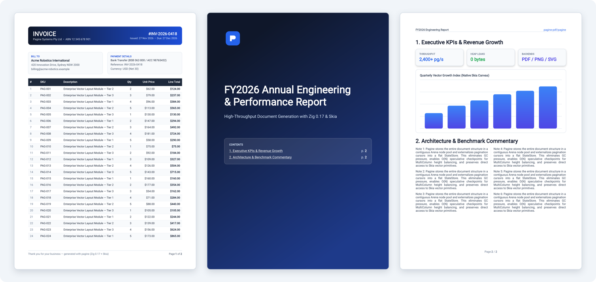

# pagine

[English](README.md) | [简体中文](README.zh_CN.md)

[](https://ziglang.org/)
[](LICENSE)

**A declarative, high-performance paginated document engine for Zig 0.17+**, inspired by .NET's QuestPDF and powered by Skia ([skia-zig](https://github.com/skia-zig/skia-zig)).

Generate invoices, executive reports, contracts, certificates, and thermal receipts straight from native Zig code — **no Headless Chrome, no manual page-break math, no GC**.

<p align="center">
  
  <br />
  <sub>Generated directly by <code>examples/invoice.zig</code> and <code>examples/report.zig</code> — multi-page tables, clickable TOC, balanced multi-column text, and native Skia Canvas charts.</sub>
</p>

---

## Why pagine?

- **Write layouts like regular Zig**: Scoped value handles (`Slot`, `ColumnBuilder`, `RowBuilder`, `TableBuilder`, `RichTextBuilder`) work directly with native `for`, `if`, `switch`, and local variables — zero closures, zero hot-path `try` noise, and sticky error collection at `validate()` / `render*()`.
- **Real automatic pagination**: Repeating headers/footers, multi-page tables with repeating table headers, automatic `totalPages()` and clickable Table of Contents, continuous roll pages (receipts), and mixed portrait/landscape page sets.
- **One document, multiple outputs**: Render the same immutable `Document` to **PDF** (including PDF/A, PDF/UA accessibility tags, and outline bookmarks), **PNG / JPEG / WebP**, or per-page **SVG**.
- **Modern styling + native Skia escape hatch**: Built-in rounded corners, dashed borders, linear gradients, drop shadows, and a typed `pagine.drawCanvas(...)` hook to draw custom charts, barcodes, or vector paths directly on `skia.Canvas`.
- **Native speed & actionable errors**: Single native binary with ReleaseFast throughput of **~530 pages/s** (`zig build bench`, 2,000-row / 55-page table in ~104 ms). Constraint conflicts fail fast with `error.LayoutOverflow` and a source-annotated diagnostic tree (`@src()`).

> **Scope note:** `pagine` focuses on **generating new paginated documents from code/data**. It does not parse, edit, or encrypt existing PDFs.

---

## Try It in 30 Seconds

### Prerequisites

- **Zig 0.17+** (`minimum_zig_version = "0.17.0"`)
- **Pure-Zig layout tests** require **zero external dependencies**.
- **Full rendering (PDF / PNG / SVG)** links [skia-zig](https://github.com/skia-zig/skia-zig) and its prebuilt Skia static libraries. By default `build.zig` looks in `../../skia-zig/skia-zig/.skia/out/<arch>-<os>-release` and can be overridden via `-Dskia-lib-dir=<dir>`.

### Run Locally

```bash
# 1. Verify the pure-Zig layout & pagination core (no Skia link required)
zig build test-core

# 2. Generate the showcase PDFs shown above
zig build run-invoice -- /tmp/pagine_invoice.pdf
zig build run-report -- /tmp/pagine_report.pdf

# (Optional) Override the prebuilt Skia library directory
zig build run-invoice -Dskia-lib-dir=/path/to/skia-prebuilt -- /tmp/pagine_invoice.pdf
```

---

## Quick Start

### 1. Add `pagine` to your project

`build.zig.zon`:

```zig
.{
    .name = .my_app,
    .version = "0.1.0",
    .minimum_zig_version = "0.17.0",
    .dependencies = .{
        .pagine = .{
            .path = "../pagine", // or fetch a pinned release URL via `zig fetch`
        },
    },
    .paths = .{ "build.zig", "build.zig.zon", "src" },
}
```

`build.zig`:

```zig
const pagine_dep = b.dependency("pagine", .{
    .target = target,
    .optimize = optimize,
    // Optional: point to your prebuilt Skia archive directory
    // .@"skia-lib-dir" = "/path/to/skia-prebuilt",
});
exe.root_module.addImport("pagine", pagine_dep.module("pagine"));
```

### 2. Generate your first PDF

```zig
const std = @import("std");
const pagine = @import("pagine");

pub fn main(init: std.process.Init) !void {
    var doc = pagine.Document.init(init.gpa, .{});
    defer doc.deinit();

    var page = doc.addPage(.{
        .size = .a4,
        .margin = .{ .all = pagine.mm(18) },
        .default_text_style = .{ .size = 10, .color = .slate_800 },
    });

    page.header().padding(.{ .bottom = 8 }).text("Hello pagine!", .{
        .size = 20,
        .weight = .bold,
        .color = .blue_700,
    });

    var col = page.content().padding(.{ .vertical = 12 }).column(.{ .spacing = 6 });
    col.item().text("Declarative, high-performance PDF generation in Zig 0.17.", .{});

    // Compose naturally with regular Zig loops and arena-backed formatting
    for (1..6) |i| {
        col.item().print("• Line item #{d} — auto-paginated with zero closures", .{i}, .{});
    }

    var ftr = page.footer().alignCenter().richText(.{ .style = .{ .size = 9, .color = .slate_500 } });
    ftr.span("Page ", .{});
    ftr.currentPageNumber(.{ .weight = .bold });
    ftr.span(" / ", .{});
    ftr.totalPages(.{ .weight = .bold });

    var pdf = try pagine.renderPdf(&doc, .{ .title = "Hello pagine" });
    defer pdf.deinit();

    try std.Io.Dir.cwd().writeFile(init.io, .{ .sub_path = "hello.pdf", .data = pdf.bytes() });
}
```

### 3. Export PNG / SVG or Register Custom Fonts

```zig
// Export the exact same `doc` as per-page PNGs or SVGs
var pngs = try pagine.renderImages(&doc, .{ .format = .png, .dpi = 144.0 });
defer pngs.deinit(); // page 1 bytes: pngs.items[0].bytes()

var svgs = try pagine.renderSvg(&doc, .{});
defer svgs.deinit();

// Load custom or CJK fonts (system fonts are used by default)
var fonts = try pagine.FontRegistry.init(.{});
defer fonts.deinit();
try fonts.registerFile("assets/NotoSansSC-Regular.ttf", "Noto Sans SC");
// Then pass `.fonts = &fonts` to `renderPdf` / `renderImages` / `renderSvg`.
```

---

## Feature Overview

| Area | Capabilities |
| --- | --- |
| **Pages & Documents** | Multi-`PageSet` layouts (fixed sizes, continuous roll, flexible bounds), 5 page slots (`background`, `header`, `content`, `footer`, `foreground`), multi-document `mergePdf` (continuous or independent numbering) |
| **Layout Containers** | `Column`, `Row` (`constant` / `relative` / `auto`), `Table` (`ColSpan` / `RowSpan` auto-placement & overlap check, repeating header/footer, extend-last-cells), `MultiColumn` (binary-search height balancing), `Inlined` flow-wrap, `Layers`, `Decoration` |
| **Pagination Controls** | `pageBreak`, `showEntire`, `ensureSpace`, `showOnce`, `skipOnce`, `stopPaging`, `repeat`, `showIf`, and page-aware stateful `dynamic` components with `measureElement` |
| **Rich Typography** | `SkParagraph` (HarfBuzz + ICU BiDi/RTL/CJK), style inheritance, paragraph spacing, first-line indent, line clamping, dynamic page numbers, clickable hyperlinks & internal section links, inline embedded widgets |
| **Visuals & Graphics** | Fused `.box(...)` (rounded corners, dashed borders, linear gradients, drop shadows), DPI-aware auto-downsampled & deduplicated images, `Svg` DOM & inline `svgPath`, typed `pagine.drawCanvas(...)` Skia escape hatch |
| **Standards & Diagnostics** | PDF/A, PDF/UA accessibility structure tags (`heading(1..6)`, `semantic(...)`), PDF Outline bookmarks, `check_missing_glyphs`, and `LayoutOverflow` constraint traces with optional `@src()` locations |

---

## Architecture & Performance

Designed for predictable latency and zero memory leaks (verified under Zig 0.17 `std.heap.SafeAllocator`):

- **Decoupled pure-Zig core**: `src/core.zig` and all layout/pagination algorithms have zero `@import("skia")` dependencies, enabling millisecond unit feedback via `zig build test-core`.
- **Immutable Arena tree + flat `StateStore`**: Document nodes live in a contiguous Arena pool (`NodeId`), while pagination cursors and `dynamic` state live in a flat `StateStore` supporting O(N) `@memcpy` `checkpoint`/`restore` without proxy-tree rewriting.
- **Two-pass pagination + caching**: Pass 1 resolves `totalPages()`, section page ranges, and caches static subtrees (`SkPicture`); Pass 2 emits pages with pre-planned `TableCache`, O(log N) row lookup, and per-page paragraph eviction.
- **Throughput reference**: `zig build bench` (ReleaseFast, 2,000-row table → 55 A4 pages, 183 KB PDF with repeating header/footer) runs in **~104 ms (~530 pages/s)** on Apple Silicon, with `FontRegistry.init(.{ .enable_paragraph_cache = false })` supported for lock-free multi-threaded rendering.

---

## Development Commands

```bash
zig build test-core                        # Pure-Zig layout core unit tests (no Skia needed)
zig build test                             # Full unit + Skia PDF/PNG/SVG integration tests
zig build examples                         # Build all curated examples
zig build run-invoice -- /tmp/invoice.pdf  # Run commercial invoice example
zig build run-report -- /tmp/report.pdf    # Run executive report example
zig build bench                            # ReleaseFast throughput benchmark
zig build fmt-check                        # Check Zig code formatting
```

---

## Documentation & FAQ

| Resource | Best for |
| --- | --- |
| [User Guide (中文)](docs/GUIDE.md) | Mental model, container recipes, fonts, canvas drawing, multi-backend export, debugging |
| [examples/invoice.zig](examples/invoice.zig) · [examples/report.zig](examples/report.zig) | Complete end-to-end documents (tables, TOC, charts, SVG, PDF/UA) |
| [Architecture & Design (中文)](docs/ARCHITECTURE.md) | Arena tree, `StateStore`, two-pass pagination, and backend internals |
| [Progress & Milestones (中文)](docs/PROGRESS.md) | Implemented milestones and engineering notes |

**Common Questions**

- **Build fails to find Skia libraries?** Pass `-Dskia-lib-dir=/path/to/skia-out` (the directory containing Skia static archives and `manifest.json`), or run `zig build test-core` to exercise the pure-Zig layout engine without Skia.
- **Missing glyphs / CJK characters showing as boxes?** `pagine` uses system fonts by default and does not bundle large font files. Register your `.ttf`/`.otf` via `FontRegistry.registerFile` or `registerBytes` (`@embedFile`), and optionally enable `.check_missing_glyphs = true` to catch missing glyphs at render time.
- **Hitting `error.LayoutOverflow`?** Pass `.diagnostic = &diag` (`pagine.LayoutDiagnostic`) to `renderPdf` and annotate suspect containers with `.source(@src())` to print the exact constraint conflict trace, or add `.debugArea("label", .red_500)` to visualize bounds.

---

## Acknowledgements & License

Inspired by [QuestPDF](https://www.questpdf.com/) and built on [skia-zig](https://github.com/skia-zig/skia-zig).

MIT — Copyright (c) 2026 Dacheng Gao. See [LICENSE](LICENSE).
