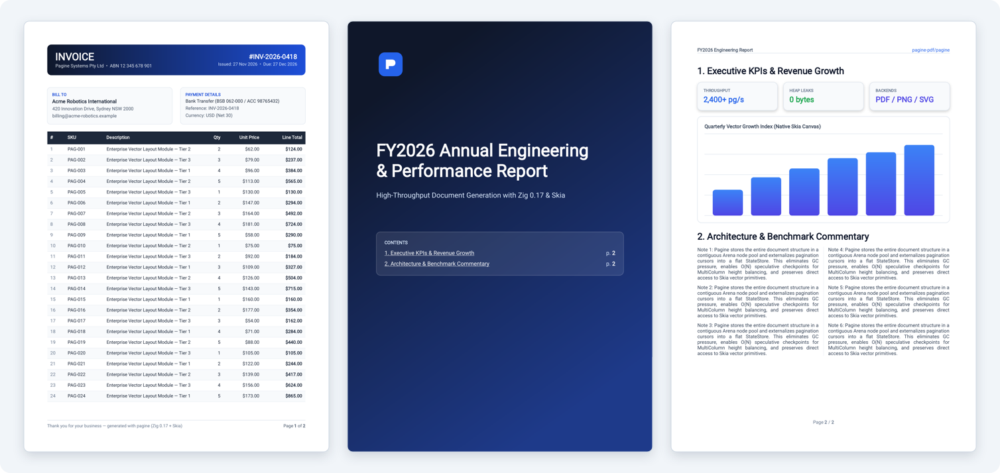

# pagine

[English](README.md) | [简体中文](README.zh_CN.md)

[](https://ziglang.org/)
[](LICENSE)

面向 **Zig 0.17+** 的高性能声明式分页文档引擎，灵感源自 .NET QuestPDF，底层基于 Skia（[skia-zig](https://github.com/skia-zig/skia-zig)）。

直接用原生 Zig 代码生成商业发票、财务研报、合同证书与热敏小票——**无需 Headless Chrome、无需手算分页坐标、零 GC 开销**。

<p align="center">
  
  <br />
  <sub>以上页面直接由 <code>examples/invoice.zig</code> 与 <code>examples/report.zig</code> 生成——涵盖跨页表格、可点击目录、多栏等高排版与原生 Skia Canvas 图表。</sub>
</p>

---

## 为什么选择 pagine？

- **像写普通 Zig 代码一样排版**：通过轻量栈值句柄（`Slot`、`ColumnBuilder`、`RowBuilder`、`TableBuilder`、`RichTextBuilder`）直接配合原生 `for` / `if` / `switch` 与局部变量——零闭包、组合期无满屏 `try`，错误统一在 `validate()` / `render*()` 边界返回。
- **开箱即用的自动分页引擎**：页眉页脚自动重复、跨页长表自动续表头、自动解析总页数 `totalPages()` 与可点击目录跳转，同时支持连续卷纸（热敏小票）与多方向纸张混排。
- **一次构建，多端导出**：同一份不可变 `Document` 可反复导出为 **PDF**（支持 PDF/A、PDF/UA 无障碍标签与书签大纲）、**PNG / JPEG / WebP** 以及逐页 **SVG**。
- **现代视觉样式 + 原生 Skia 画布逃生舱**：内置圆角、虚线边框、线性渐变与阴影；需要画图表、条码或复杂矢量路径时，可通过类型安全的 `pagine.drawCanvas(...)` 直接操作 `skia.Canvas`。
- **原生速度与清晰排错**：单二进制无浏览器依赖，ReleaseFast 实测吞吐 **~530 页/秒**（`zig build bench`，2,000 行 / 55 页长表约 104 ms）。布局约束冲突时立刻返回 `error.LayoutOverflow`，支持输出含 `@src()` 源码定位的诊断树。

> **定位边界**：`pagine` 专注于**从代码与数据生成新文档**，不包含对已有 PDF 的解析、修改或加密功能。

---

## 30 秒本地体验

### 环境前置

- **Zig 0.17+**（`minimum_zig_version = "0.17.0"`）
- **纯 Zig 布局核心测试**：**零外部依赖**，拉下代码即可直接运行。
- **完整文档渲染（PDF / PNG / SVG）**：依赖 [skia-zig](https://github.com/skia-zig/skia-zig) 及其预编译 Skia 静态库；`build.zig` 默认查找 `../../skia-zig/skia-zig/.skia/out/<arch>-<os>-release`，可通过 `-Dskia-lib-dir=<dir>` 覆盖。

### 立即运行

```bash
# 1. 运行纯 Zig 布局与分页核心测试（无需链接 Skia）
zig build test-core

# 2. 生成上方预览图对应的商业发票与研报 PDF
zig build run-invoice -- /tmp/pagine_invoice.pdf
zig build run-report -- /tmp/pagine_report.pdf

# （可选）显式指定 Skia 预编译库目录
zig build run-invoice -Dskia-lib-dir=/path/to/skia-prebuilt -- /tmp/pagine_invoice.pdf
```

---

## 快速开始

### 1. 在项目中引入 `pagine`

`build.zig.zon`：

```zig
.{
    .name = .my_app,
    .version = "0.1.0",
    .minimum_zig_version = "0.17.0",
    .dependencies = .{
        .pagine = .{
            .path = "../pagine", // 或通过 `zig fetch` 引入远程发布版本
        },
    },
    .paths = .{ "build.zig", "build.zig.zon", "src" },
}
```

`build.zig`：

```zig
const pagine_dep = b.dependency("pagine", .{
    .target = target,
    .optimize = optimize,
    // 若 Skia 预编译库不在默认相对路径，可显式指定：
    // .@"skia-lib-dir" = "/path/to/skia-prebuilt",
});
exe.root_module.addImport("pagine", pagine_dep.module("pagine"));
```

### 2. 生成第一份 PDF

```zig
const std = @import("std");
const pagine = @import("pagine");

pub fn main(init: std.process.Init) !void {
    var doc = pagine.Document.init(init.gpa, .{});
    defer doc.deinit();

    var page = doc.addPage(.{
        .size = .a4,
        .margin = .{ .all = pagine.mm(18) },
        .default_text_style = .{ .size = 10, .color = .slate_800 },
    });

    page.header().padding(.{ .bottom = 8 }).text("Hello pagine!", .{
        .size = 20,
        .weight = .bold,
        .color = .blue_700,
    });

    var col = page.content().padding(.{ .vertical = 12 }).column(.{ .spacing = 6 });
    col.item().text("使用 Zig 0.17 + Skia 构建高性能声明式 PDF 文档。", .{});

    // 直接配合原生 Zig 循环与文档内 Arena 格式化
    for (1..6) |i| {
        col.item().print("• 第 {d} 条明细 —— 自动分页，零闭包样板", .{i}, .{});
    }

    var ftr = page.footer().alignCenter().richText(.{ .style = .{ .size = 9, .color = .slate_500 } });
    ftr.span("第 ", .{});
    ftr.currentPageNumber(.{ .weight = .bold });
    ftr.span(" 页 / 共 ", .{});
    ftr.totalPages(.{ .weight = .bold });
    ftr.span(" 页", .{});

    var pdf = try pagine.renderPdf(&doc, .{ .title = "Hello pagine" });
    defer pdf.deinit();

    try std.Io.Dir.cwd().writeFile(init.io, .{ .sub_path = "hello.pdf", .data = pdf.bytes() });
}
```

### 3. 导出 PNG / SVG 与注册中文字体

```zig
// 同一份 `doc` 直接导出逐页 PNG 或 SVG
var pngs = try pagine.renderImages(&doc, .{ .format = .png, .dpi = 144.0 });
defer pngs.deinit(); // 第 1 页字节：pngs.items[0].bytes()

var svgs = try pagine.renderSvg(&doc, .{});
defer svgs.deinit();

// 注册自定义字体或中文字体（默认走系统字体，不强制内嵌大字体文件）
var fonts = try pagine.FontRegistry.init(.{});
defer fonts.deinit();
try fonts.registerFile("assets/NotoSansSC-Regular.ttf", "Noto Sans SC");
// 随后在 renderPdf / renderImages / renderSvg 中传入 `.fonts = &fonts`
```

---

## 核心能力一览

| 维度 | 支持能力 |
| --- | --- |
| **页面与文档** | 多 `PageSet` 混排（固定纸张 / 连续卷纸 / 弹性尺寸）、5 页面槽位（`background` / `header` / `content` / `footer` / `foreground`）、多文档 `mergePdf`（连续或独立页码） |
| **布局容器** | `Column`、`Row`（`constant` / `relative` / `auto`）、`Table`（`ColSpan` / `RowSpan` 自动排布与重叠校验、跨页重复表头表尾）、`MultiColumn`（二分高度均衡）、`Inlined` 流式换行、`Layers`、`Decoration` |
| **分页控制** | `pageBreak`、`showEntire`、`ensureSpace`、`showOnce`、`skipOnce`、`stopPaging`、`repeat`、`showIf`，以及支持 `measureElement` 子元素测量的页感知 `dynamic` 组件 |
| **富文本与国际化** | 基于 `SkParagraph`（HarfBuzz + ICU，支持 CJK / RTL / BiDi）、样式继承、段落间距、首行缩进、行数截断、动态页码、行内超链接与章节跳转、行内嵌入组件 |
| **视觉与图形** | 融合容器 `.box(...)`（圆角、虚线边框、线性渐变、阴影）、DPI 感知图片自动下采样与去重、矢量 `Svg` 与内联 `svgPath`、`pagine.drawCanvas(...)` 原生 Skia 绘图 |
| **标准与诊断** | PDF/A、PDF/UA 无障碍结构标签（`heading(1..6)`、`semantic(...)`）、PDF 书签大纲、`check_missing_glyphs` 缺字检测、`LayoutOverflow` 约束追踪树（支持 `@src()` 源码定位） |

---

## 架构与性能亮点

面向确定性低延迟与零内存泄漏设计（全量测试通过 Zig 0.17 `std.heap.SafeAllocator` 零泄漏校验）：

- **纯 Zig 布局核心与渲染解耦**：`src/core.zig` 及全部排版/分页算法零 `@import("skia")` 依赖，`zig build test-core` 无需链接 Skia 即可毫秒级验证核心逻辑。
- **不可变 Arena 树 + 外置平铺 `StateStore`**：文档节点紧凑存储在连续 Arena 节点池（`NodeId`）；分页游标与 `dynamic` 状态独立存放在平铺缓冲区，通过 O(N) `@memcpy` 实现 `checkpoint`/`restore`，无需代理树重写。
- **两阶段分页与生产级缓存**：第一阶段解析 `totalPages()`、章节页码并缓存静态子树（`SkPicture`）；第二阶段结合预规划 `TableCache`、O(log N) 行二分定位与逐页段落淘汰输出页面。
- **吞吐实测参考**：Apple Silicon 下运行 `zig build bench`（ReleaseFast，2,000 行长表 → 55 页 A4 / 183 KB PDF，含重复页眉页脚与表头），总耗时约 **104 ms（~530 页/秒）**；高并发服务端可配合 `FontRegistry.init(.{ .enable_paragraph_cache = false })` 无锁并行渲染。

---

## 常用开发命令

```bash
zig build test-core                        # 纯 Zig 布局核心单元测试（无需链接 Skia）
zig build test                             # 全量单元测试 + Skia PDF/PNG/SVG 集成测试
zig build examples                         # 构建全部精选示例
zig build run-invoice -- /tmp/invoice.pdf  # 生成商业发票示例 PDF
zig build run-report -- /tmp/report.pdf    # 生成财务研报示例 PDF
zig build bench                            # ReleaseFast 多页吞吐性能基准
zig build fmt-check                        # Zig 代码格式检查
```

---

## 文档与常见问题

| 资源 | 适用对象与内容 |
| --- | --- |
| [开发者使用指南](docs/GUIDE.md) | 接入方式、核心心智模型、高频布局配方、字体与 Canvas、多后端导出与排错 |
| [examples/invoice.zig](examples/invoice.zig) · [examples/report.zig](examples/report.zig) | 完整端到端实战代码（跨页表格、可点击目录、矢量图表、SVG、PDF/UA） |
| [架构与设计文档](docs/ARCHITECTURE.md) | Arena 节点树、`StateStore`、两阶段分页引擎与后端架构详解 |
| [开发进度与交接存档](docs/PROGRESS.md) | 里程碑演进记录与工程决策 |

**常见问题**

- **构建时报找不到 Skia 静态库？** 通过 `-Dskia-lib-dir=/path/to/skia-out` 指定包含 Skia 静态库与 `manifest.json` 的目录；若只想体验或调试布局算法，直接运行 `zig build test-core` 即可零依赖测试。
- **中文或特殊符号显示为方块？** `pagine` 默认使用系统字体，不随核心库强绑大字体文件。请用 `FontRegistry.registerFile` 或 `registerBytes`（配合 `@embedFile`）注册 `.ttf`/`.otf`，并可开启 `.check_missing_glyphs = true` 在渲染阶段即时发现缺字。
- **遇到 `error.LayoutOverflow` 如何定位？** 在 `renderPdf` 中传入 `.diagnostic = &diag`（`pagine.LayoutDiagnostic`）并给可疑容器加上 `.source(@src())` 打印精确约束冲突链；也可临时挂载 `.debugArea("label", .red_500)` 可视化布局边界。

---

## 致谢与许可证

灵感源自 [QuestPDF](https://www.questpdf.com/)，底层图形与排版由 [skia-zig](https://github.com/skia-zig/skia-zig) 驱动。

MIT — Copyright (c) 2026 Dacheng Gao，详见 [LICENSE](LICENSE)。
